# Smart Distribution Grid Optimization
### PV + EV Charging + Battery Energy Storage on the IEEE 33-bus feeder

Python framework for **quasi-static AC time-series simulation** and **MILP-based coordination**
of rooftop PV, EV home charging and a grid battery on a 12.66 kV radial distribution feeder.
Every optimized schedule is **independently validated with full AC power flow** (pandapower)
in an iterative correction loop.

`pandapower` · `Pyomo` · `HiGHS` · `pandas` · `NumPy` · `matplotlib` · `pytest`

> All numbers in this README are produced by the scripts in `scripts/` and can be
> regenerated from `config/config.yaml`. Assumptions are labelled as such; the full
> derivation is in [`docs/technical_report.md`](docs/technical_report.md).

---

## Engineering problem
Distribution feeders were planned for one-directional power flow and diversified household load.
Large numbers of EVs and rooftop PV systems change this:

* **EV home charging** coincides with the residential evening peak, so it raises transformer
  loading and the voltage drop at the end of long feeders.
* **Rooftop PV** reverses the power flow at midday, raising voltages and eventually
  overloading the transformer in reverse direction.
* **Batteries and smart charging** can shift energy in time, but only if their dispatch respects
  the physical limits of the network.

This project quantifies these effects on a standard test feeder and shows how coordinated EV/BESS
dispatch, verified by AC power flow, keeps the feeder within its voltage and thermal limits.

## Objectives
1. Build a validated, reproducible model of the IEEE 33-bus feeder with a substation transformer and OLTC.
2. Quantify the impact of increasing PV, EV and BESS penetration with 24 h AC time-series power flow.
3. Coordinate EV charging, BESS dispatch and PV curtailment with a MILP that minimizes operating
   cost while respecting voltage, transformer and line limits.
4. Validate every optimized schedule with AC power flow and report any remaining violation.

---

## System architecture

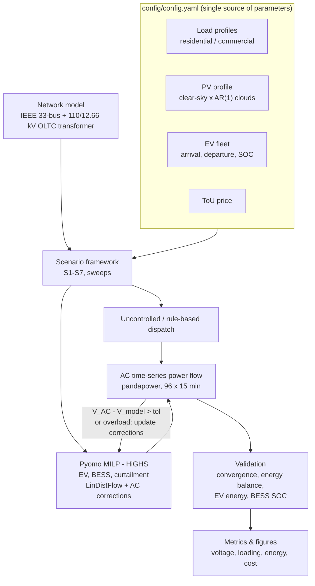

### Workflow

```
Load / PV / EV / price profiles
        ↓
Distribution network (IEEE 33-bus + OLTC transformer)
        ↓
Baseline AC power flow (S1)
        ↓
Scenario analysis (S2-S5, uncontrolled / rule-based)
        ↓
Pyomo optimization (S6-S7)
        ↓
Optimized EV / BESS / curtailment schedule
        ↓
AC power-flow validation  ⟲  correct & re-optimize
        ↓
Engineering metrics
        ↓
Results & visualization
```

### Repository layout
```
config/config.yaml           all parameters, assumptions and scenario definitions
src/grid/network.py          IEEE 33-bus model, transformer/OLTC, line ratings, DER elements
src/profiles/                load, PV, EV fleet and price profiles (deterministic, seeded)
src/models/                  EV charging model, BESS model (SOC dynamics, validation, rule-based)
src/simulation/              AC time-series power flow, scenario framework
src/optimization/            LinDistFlow sensitivities, Pyomo MILP, iterative AC validation
src/analysis/                metrics, experiments, figures
scripts/                     command-line entry points
tests/                       pytest suite
notebooks/                   executed analysis notebooks (01-05)
docs/technical_report.md     full methodology, equations, results and interpretation
results/                     generated tables and figures
```

---

## Models (summary; details and equations in the [technical report](docs/technical_report.md))

| Component | Model | Key parameters |
|---|---|---|
| **Network** | pandapower `case33bw` (Baran & Wu 1989), validated against the published 202.7 kW losses and 0.9131 pu minimum. Tie lines removed. | 12.66 kV, 32 branches, 3.715 MW / 2.30 Mvar nominal load |
| **Substation** *(assumption)* | 110/12.66 kV transformer with OLTC and automatic voltage regulator | 5 MVA, u<sub>k</sub> 8 %, ±9 × 1.25 % taps, deadband 0.995–1.015 pu |
| **Lines** *(assumption)* | Discrete ampacities sized for 60 % utilization at nominal peak | 27 × 150 A, 3 × 300 A, 2 × 400 A |
| **Load** | Residential (evening peak) and commercial (office hours) shapes, seeded noise, constant power factor | 48.5 % of nominal load commercial |
| **PV** | Clear-sky sine × AR(1) cloud index × performance ratio, unity power factor, distributed over all load buses | 6.84 kWh/kWp/day, penetration = kWp / 3.715 MW |
| **EV** | 150 home-charging sessions (arrival ~18:00, departure ~07:00), 40–77 kWh, 7.4/11 kW, η 0.92, target SOC 80 % | uncontrolled or optimized |
| **BESS** | SOC dynamics with separate charge/discharge efficiency; binary charge/discharge exclusivity in the MILP | 1 MWh / 500 kW at IEEE bus 18, SOC 10–90 % |
| **Price** | *Synthetic* time-of-use tariff (not a real German tariff) | 0.18–0.42 EUR/kWh import, 0.08 EUR/kWh export |
| **Time** | 96 × 15 min, noon to noon, so overnight charging sessions fit in one window | seed 42 |

### Optimization formulation
Pyomo MILP solved with **HiGHS** (CBC as fallback):

$$\min \underbrace{\sum_t (c^{imp}_t P^{imp}_t - c^{exp}_t P^{exp}_t)\Delta t}_{\text{energy cost}} + \underbrace{c^{peak} P^{peak}}_{\text{demand charge}} + \underbrace{c^{V}\sum_{n,t}(s^{lo}_{n,t}+s^{hi}_{n,t})\Delta t}_{\text{voltage penalty (soft limit)}} + \underbrace{c^{curt}\sum_{n,t}P^{curt}_{n,t}\Delta t}_{\text{PV curtailment}} + \underbrace{c^{deg}\sum_t \tfrac{P^{ch}_t+P^{dis}_t}{2}\Delta t}_{\text{BESS degradation}}$$

Each term is in EUR and has a configurable weight. Constraints:
* **EV:** charging only while connected, charger rating, exact energy requirement, charging efficiency.
* **BESS:** SOC dynamics with efficiency, SOC limits, power limits, binary charge/discharge mode, terminal SOC ≥ initial.
* **Grid:** bus and grid power balance (with AC losses), transformer and line thermal limits (P with Q fixed from AC), **LinDistFlow voltage constraints** with AC-derived correction terms and a 0.002 pu safety margin.

### Optimization ↔ AC power-flow validation
The optimizer never has the final word on grid compliance:

1. An AC run of the uncontrolled reference dispatch provides the busbar voltage, losses, reactive flows and the LinDistFlow error at every bus and step.
2. The MILP is solved with these corrections.
3. The schedule is applied to the pandapower network and a **full AC time-series power flow** is run.
4. If the AC voltages differ from the model by more than 0.002 pu, or a thermal limit is exceeded, the corrections are recomputed at the new operating point (violated limits are derated) and the MILP is solved again.

Residual violations are reported, never hidden.

---

## Results
Generated by `scripts/run_*.py` → [`results/scenario_comparison.md`](results/scenario_comparison.md).
Main scenarios: 150 % PV (5.57 MWp), 150 EVs, 1 MWh BESS.

| Scenario | Peak import [kW] | Min V [pu] | Violation bus-steps | Max trafo [%] | Losses [kWh] | Total cost [EUR/day] |
|:---|---:|---:|---:|---:|---:|---:|
| S1 Baseline | 3,087 | 0.9329 | 540 | 76.1 | 2,284 | 16,996 |
| S2 High PV | 2,786 | 0.9283 | 130 | 65.8 | 1,248 | 7,119 |
| S3 High EV (uncontrolled) | 3,989 | 0.9115 | 712 | 90.1 | 2,576 | 18,924 |
| S4 PV + EV | 3,516 | 0.9238 | 142 | 79.5 | 1,443 | 8,941 |
| S5 PV + EV + BESS (rule-based) | 3,127 | 0.9299 | 90 | 73.1 | 1,407 | 8,803 |
| S6 Smart charging | 2,786 | 0.9283 | 130 | 65.8 | 1,400 | 7,921 |
| **S7 Smart charging + BESS** | **2,380** | **0.9508** | **0** | **58.5** | 1,419 | **7,575** |

*Violation bus-steps* count (bus, 15-min step) pairs outside 0.95–1.05 pu. Line loading never exceeds 50 %.
Every scenario's 96 power flows converged, with an energy-balance residual below 1e-6 kWh.

| | |
|---|---|
| 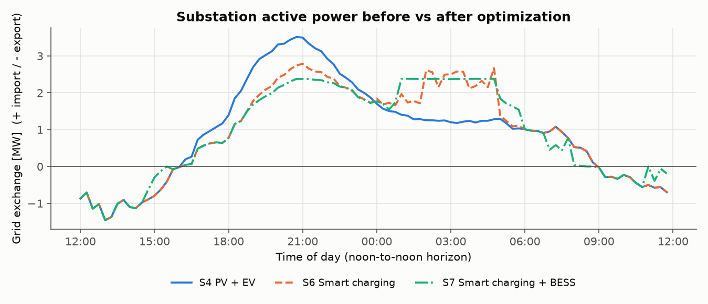 | 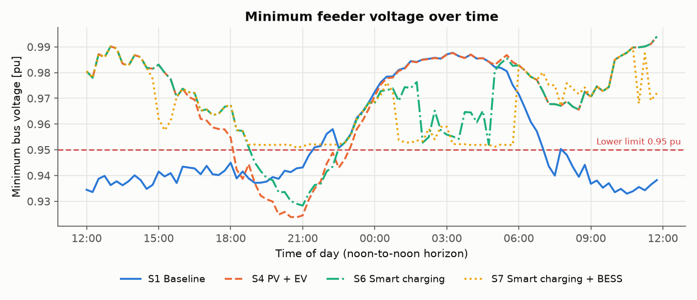 |
| 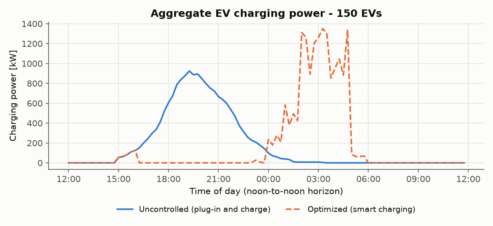 | 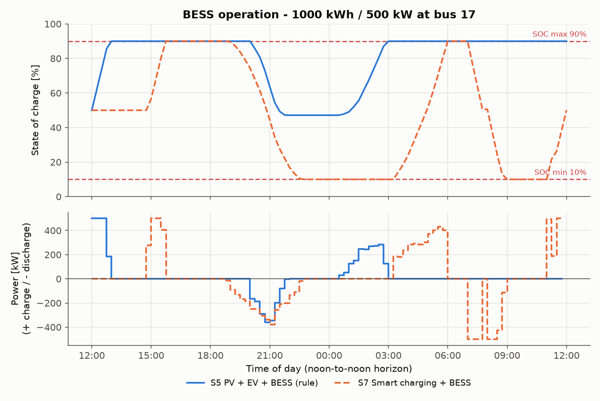 |
| 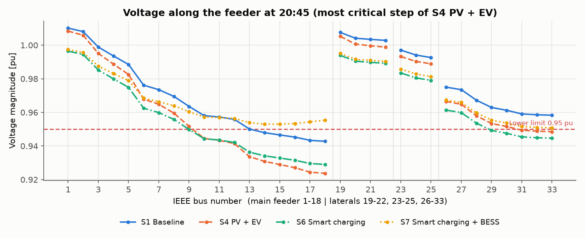 | 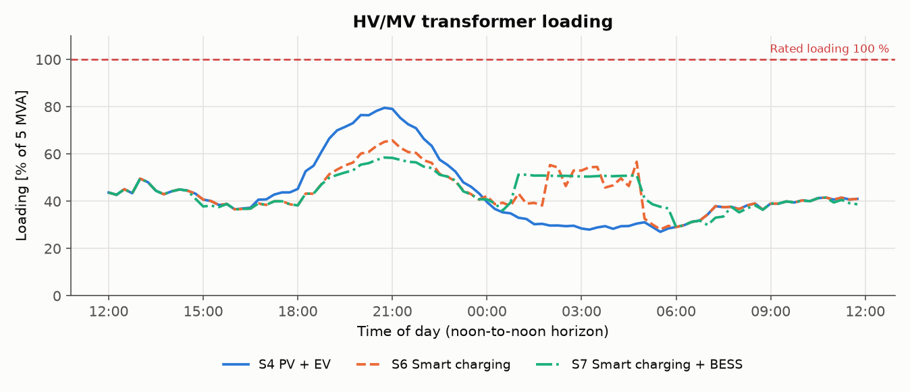 |

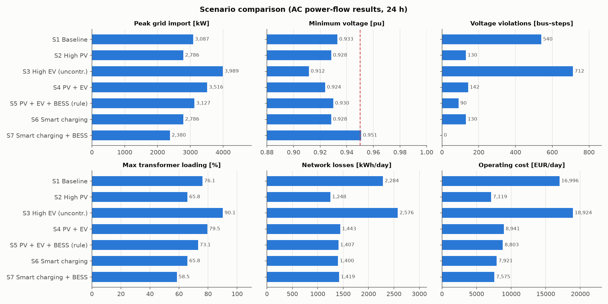

**Optimization (S7):** objective 7,584.32 EUR = 6,780.69 energy + 713.19 demand charge + 80.11 degradation + 10.33 voltage penalty (margin use only).
HiGHS found the optimum (0.1 % gap) in each of 3 AC-validation iterations, and the final model–AC voltage mismatch is 0.0015 pu.
All 150 EVs reach exactly 80 % SOC, and the BESS SOC stays within 10–90 %.

### Experiments
| | |
|---|---|
| 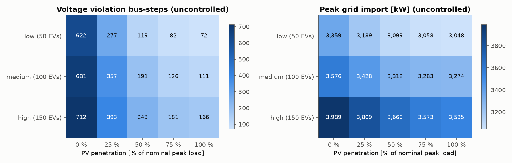 | 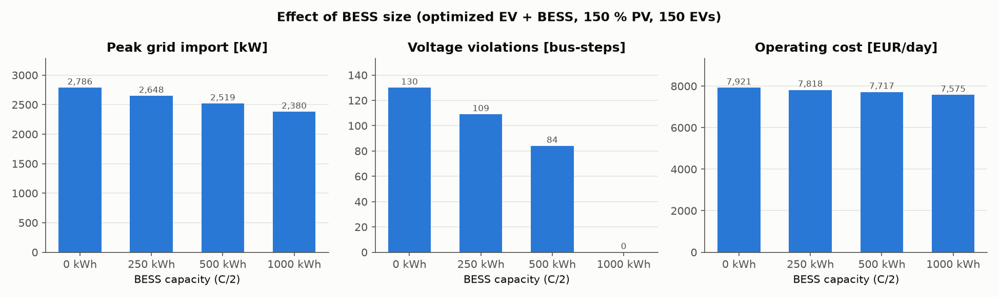 |
| 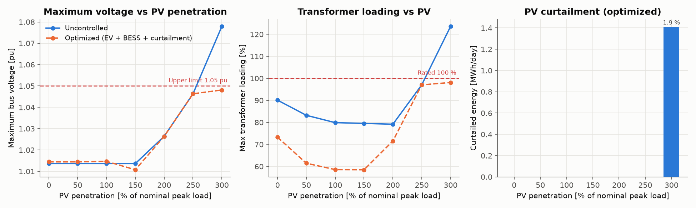 | 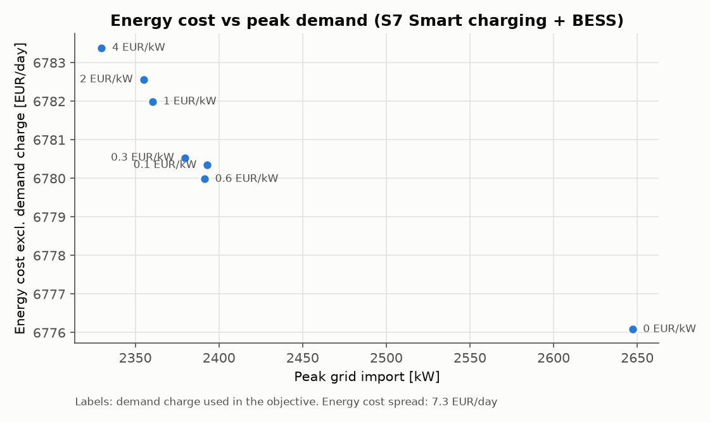 |

Tables: [`results/tables/`](results/tables/) (PV × EV, hosting capacity, BESS size, EV control, demand charge, OLTC setpoint).

---

## Key findings
1. **Voltage, not thermal capacity, limits this feeder.** Line loading stays below 50 % in every case, yet the baseline already has 540 undervoltage bus-steps. The 33-bus feeder is long and resistive, so active power at its far end (IEEE buses 10–18, 29–33) drives the voltage drop.
2. **Uncontrolled EV charging stacks on the evening peak.** 150 EVs add 924 kW at 19:15. In S3 the substation peak rises by 29 % (3,087 → 3,989 kW) and transformer loading from 76 % to 90 %.
3. **This feeder absorbs PV well up to about 250 % of peak load.** Commercial midday demand absorbs 100 % PV (only 2 kWh exported). At 300 %, uncontrolled operation reaches 1.078 pu and 124 % reverse transformer loading. The optimized dispatch stays within limits by curtailing only 1.85 % of PV energy.
4. **Smart charging moves EV energy into 00:00–06:00.** It cuts the peak by 21 % and energy cost by 10 % versus S4, but leaves the base-load undervoltage (130 bus-steps).
5. **The OLTC interacts with smart charging.** Smart charging keeps the busbar just inside the regulator's deadband, so the tap does not step up. With a raised OLTC setpoint (1.015–1.035 pu), S6 has **zero** violations. Coordinating the substation regulator matters as much as the DER dispatch.
6. **Smart charging plus a 1 MWh BESS at the feeder end removes all violations.** Versus S4 it cuts the peak by 32 % (to 2,380 kW) and total cost by 15 %. A rule-based BESS of the same size achieves only −11 % peak and leaves 90 violation bus-steps.

## Limitations
Synthetic representative-day profiles with perfect foresight; a balanced MV model (no LV
networks or unbalance); unity-power-factor inverters; linearized grid model in the optimizer
(corrected by AC iterations; 2 of 27 optimized runs reached the iteration cap and kept their
best AC iteration); assumed transformer, line, BESS and cost parameters.
See [Limitations](docs/technical_report.md#15-limitations) and [Future work](docs/technical_report.md#16-future-work).

## Future improvements
OLTC setpoint co-optimization · Q(V) inverter control · stochastic / rolling-horizon dispatch ·
seasonal studies · three-phase LV modelling · BESS siting and sizing · V2G · measured input data.

---

## Technology stack
| Purpose | Tool |
|---|---|
| AC power flow | pandapower 3.5.6 (Newton–Raphson, numba-accelerated) |
| Optimization | Pyomo 6.10.1 + HiGHS 1.16 (`appsi_highs`); CBC fallback |
| Data | pandas 2.3, NumPy 2.4 |
| Figures | matplotlib 3.11 |
| Configuration | YAML |
| Testing | pytest (52 tests) |
| Python | 3.11 |

## Installation
```bash
git clone <repository-url>
cd smart-distribution-grid
python -m venv .venv
```
Activate the environment (`.venv\Scripts\activate` on Windows, `source .venv/bin/activate` on Linux/macOS), then:
```bash
pip install -r requirements.txt
```

## Running the project
```bash
python scripts/run_baseline.py        # S1: baseline metrics (~5 s)
python scripts/run_scenarios.py       # S1-S5: uncontrolled / rule-based scenarios
python scripts/run_optimization.py    # S6-S7: MILP + iterative AC validation
python scripts/run_experiments.py     # parameter sweeps (~45 min on a laptop)
python scripts/generate_results.py    # comparison tables + all figures
pytest                                # test suite
```
Change any parameter in `config/config.yaml` (PV level, EV count, BESS size, prices, limits,
weights, scenarios) and rerun. All synthetic data are seeded, so the same configuration
always gives the same results.

The notebooks in `notebooks/` (network validation, profiles, baseline, scenarios,
optimization) read the saved results. Run the scripts first.

## License
MIT. See [LICENSE](LICENSE).
