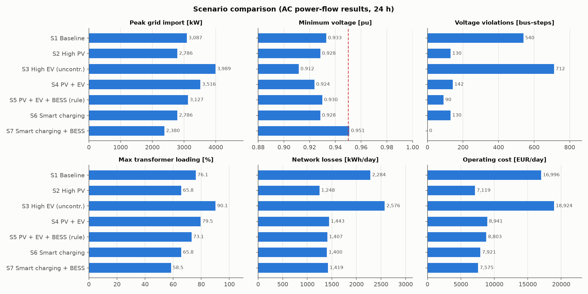
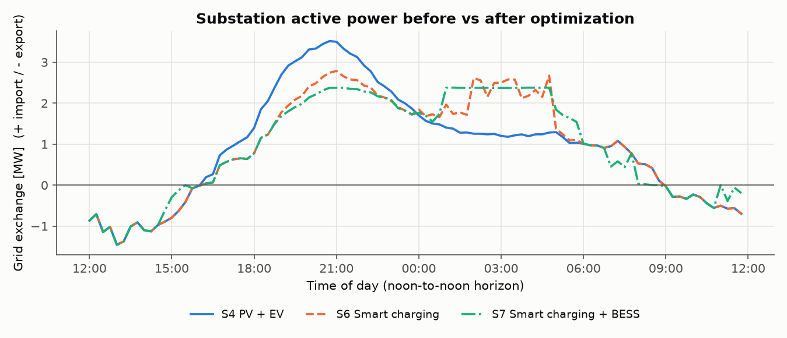
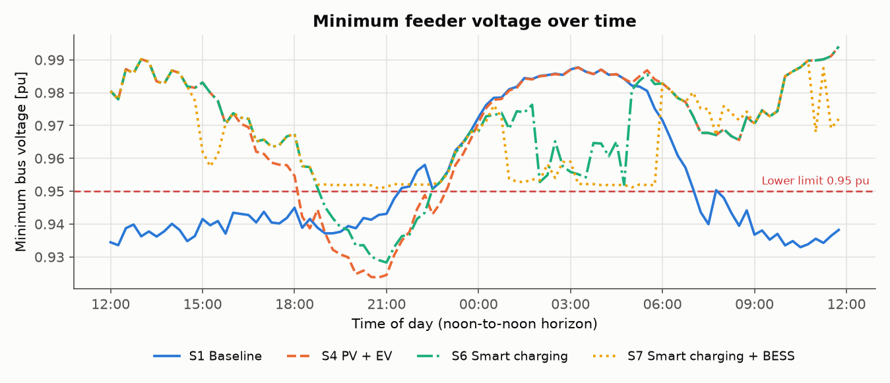

# Technical Report: Smart Distribution Grid Optimization with PV, EV Charging and Battery Storage

All numerical results in this report come from the simulation outputs in
`results/` (generated by the scripts in `scripts/`). Parameters and assumptions
are defined in `config/config.yaml`. The text separates four kinds of statement:

* **[Result]**: a value computed by the simulation.
* **[Assumption]**: an engineering assumption made for this study.
* **[Parameter]**: a configurable input value.
* **[Interpretation]**: engineering reasoning about the results.

---

## 1. Distribution network

### 1.1 Source data
The study uses the IEEE 33-bus radial distribution feeder (Baran & Wu, 1989,
*"Network reconfiguration in distribution systems for loss reduction and load
balancing"*, IEEE Trans. Power Delivery 4(2)) as implemented in pandapower
(`pandapower.networks.case33bw`). The unmodified case is validated against the
published reference (`tests/test_network.py`, `notebooks/01_network_validation.ipynb`):

| Quantity | Published | pandapower `case33bw` [Result] |
|---|---:|---:|
| Active losses at nominal load | 202.7 kW | 202.7 kW |
| Minimum voltage | 0.9131 pu (bus 18) | 0.9131 pu (bus 18) |

Nominal values: 12.66 kV, 33 buses, 32 branches (plus 5 normally-open tie lines),
total load 3.715 MW / 2.300 Mvar.

### 1.2 Documented modifications
| # | Modification | Reason |
|---|---|---|
| 1 | The five normally-open tie lines are removed. | They are out of service in the standard case; the radial feeder is studied. |
| 2 | **[Assumption]** The ideal 12.66 kV slack is replaced by a 110 kV external grid and a 110/12.66 kV, 5 MVA transformer (u<sub>k</sub> = 8 %, u<sub>kr</sub> = 0.5 %, P<sub>Fe</sub> = 5 kW) with an on-load tap changer (±9 × 1.25 %). An automatic voltage regulator keeps the MV busbar within 0.995–1.015 pu. | Makes transformer loading and reverse power flow observable. The rating is about 1.15 × the feeder's nominal apparent power (4.37 MVA). |
| 3 | **[Assumption]** Line thermal ratings: each line gets the smallest standard ampacity in {150, 200, 300, 400} A whose 60 % utilization covers its current at nominal peak load. Result: 27 lines at 150 A, 3 at 300 A and 2 at 400 A. | The standard case has no thermal ratings. |
| 4 | **[Assumption]** Loads ≥ 150 kW (buses 6, 7, 23, 24, 29, 30, 31 in 0-based pandapower indices) are treated as commercial; the rest are residential. The commercial share of nominal load is 48.5 %. | Different daily profiles. |
| 5 | PV, EV and BESS are added as separate pandapower elements (`sgen`, `load`, `storage`). | They can be updated independently in the time series. |

Bus numbering: the code uses pandapower's 0-based indices. The **IEEE bus number = index + 1**,
and the figures and README use IEEE numbering.

### 1.3 Limits
* **[Assumption]** Voltage band 0.95–1.05 pu. This is a planning band, stricter
  than the ±10 % of EN 50160, because it leaves headroom for LV-network voltage drop.
* Line and transformer loading limit: 100 % of rating.

---

## 2. Mathematical assumptions
* Balanced three-phase operation, positive-sequence model (pandapower AC power flow).
* Quasi-static time series: 96 steady-state power flows at 15-min resolution;
  no dynamics within a step.
* Constant power factor for every base load, scaled with its profile.
* PV inverters, EV chargers and the BESS operate at unity power factor.
* **[Assumption]** The horizon runs **noon to noon** (2025-06-16 12:00 to
  2025-06-17 11:45). Overnight home-charging sessions then lie entirely inside
  one optimization window, which is common practice in EV scheduling studies.
* All synthetic data are deterministic (seed 42, independent sub-streams per profile).

---

## 3. Load model
Hourly normalized shapes for residential load (evening peak) and commercial load
(office-hours plateau) are linearly interpolated to 15 min. They are perturbed
with ±2 % seeded multiplicative noise and normalized to a peak of 1.0. The load
at bus *i* is

$$P_i(t) = P_{i}^{\text{nom}} \cdot m_{c(i)}(t), \qquad Q_i(t) = Q_{i}^{\text{nom}} \cdot m_{c(i)}(t)$$

where $c(i)$ is the bus class. Because the two classes peak at different times,
the coincident feeder peak is below the 3.715 MW sum of nominal loads.

---

## 4. PV model
Clear-sky shape × stochastic clear-sky index × performance ratio:

$$p^{\text{PV}}(t) = \Big[\sin\big(\pi\,\tfrac{t - t_{\text{rise}}}{t_{\text{set}} - t_{\text{rise}}}\big)\Big]^{1.2} \cdot k(t) \cdot \text{PR}\cdot f_{\text{season}}$$

* [Assumption] Sunrise 05:00 and sunset 21:00 (mid-June, central Europe), PR = 0.80, $f_\text{season}$ = 1.
* $k(t)$ is a stationary AR(1) process (mean 0.92, σ 0.08, φ 0.85) clipped to [0.3, 1].
* [Result] Daily yield 6.84 kWh/kWp, peak 0.79 kW/kWp.
* **Penetration** is defined as installed kWp relative to the feeder's nominal peak load
  (3.715 MW). It is distributed over all load buses in proportion to their nominal load
  (rooftop PV follows customers).

---

## 5. EV model
Each EV *e* has an arrival and departure time, battery capacity $C_e$, initial SOC
$s_e^0$, target SOC $s_e^\text{tgt}$, charger rating $\bar P_e$ and efficiency $\eta_e$.

* [Assumption] Home charging: arrival ~ N(18:00, 1.5 h) truncated to 15:00–23:00;
  departure ~ N(07:00, 0.75 h) truncated to 05:00–10:00 on the next day.
* Battery 40 / 60 / 77 kWh; initial SOC U(0.2, 0.5); target SOC 0.8;
  charger 7.4 kW (single-phase) or 11 kW (three-phase); η = 0.92.
* EVs are allocated to residential buses in proportion to their nominal load.
* Required battery-side energy: $E_e = (s_e^{\text{tgt}} - s_e^0)\,C_e$. If this
  exceeds $\bar P_e\,\eta_e \times$ connected time, the requirement is capped and a
  warning is logged. This did not occur for the generated fleets.
* **[Assumption] Penetration levels:** low / medium / high = 50 / 100 / 150 EVs,
  i.e. about 0.45 / 0.90 / 1.35 MW of installed charging power, or roughly
  12 / 24 / 36 % of the feeder's nominal peak load.

Control modes:
* **Uncontrolled:** charge at $\bar P_e$ from arrival until $E_e$ is delivered;
  the last step uses partial power.
* **Optimized:** the schedule is a decision of the MILP (Section 8).

---

## 6. Battery model
Grid-connected BESS at bus 17 (IEEE bus 18, the end of the main feeder) **[Assumption]**,
with power = 0.5 C (C/2). Energy dynamics:

$$E(t+1) = E(t) + \eta_\text{ch} P_\text{ch}(t)\,\Delta t - \frac{P_\text{dis}(t)\,\Delta t}{\eta_\text{dis}}$$

$$\text{SOC}_\min C \le E(t) \le \text{SOC}_\max C,\quad 0 \le P_\text{ch} \le \bar P,\quad 0 \le P_\text{dis} \le \bar P$$

[Parameter] SOC 10–90 %, initial 50 %, η<sub>ch</sub> = η<sub>dis</sub> = 0.95,
degradation cost 0.05 EUR/kWh of throughput.

Simultaneous charging and discharging is prevented in two ways. The simulation
model takes a single signed setpoint per step, and the MILP uses a binary mode
variable. `validate_battery_schedule` checks every schedule independently.

**Rule-based dispatch (S5):** charge when the feeder net demand is below 1.5 MW
and discharge when it is above 3.0 MW, in each case only by the amount needed to
reach the threshold. No forecast is used.

---

## 7. Power-flow methodology
`src/simulation/power_flow.py` runs a Newton–Raphson AC power flow (pandapower)
for each of the 96 steps:

1. update base loads, PV infeed (available minus curtailed), EV loads and BESS power;
2. run the power flow with the OLTC controller active (the tap position carries
   over between steps, as in a real substation);
3. store bus voltages, line loading and P/Q flows, transformer loading and tap
   position, and grid exchange and losses (line + transformer).

A non-converged step is logged together with its operating point and stored as NaN.
`validate_result` then raises an error, so a failure is never silently ignored.
**[Result]** All steps of all runs in this study converged.

---

## 8. Optimization formulation
Implemented in Pyomo (`src/optimization/model.py`) and solved with **HiGHS 1.16**
through Pyomo's APPSI interface; CBC is the fallback. The model is a MILP
with about 21,000 variables, 16,500 constraints and 96 binaries (S7).

### 8.1 Decision variables
| Variable | Meaning |
|---|---|
| $p^{EV}_{e,t} \in [0, \bar P_e]$ | EV charging power, only for steps when the EV is connected |
| $p^{ch}_t, p^{dis}_t, y_t\in\{0,1\}, E_t$ | BESS charge, discharge, mode, energy |
| $p^{curt}_{n,t} \in [0, p^{PV,avail}_{n,t}]$ | PV curtailment |
| $p^{imp}_t, p^{exp}_t \ge 0,\; p^{peak}$ | grid import, export and peak import |
| $p_{n,t}$ | net active consumption per bus (auxiliary) |
| $s^{lo}_{n,t}, s^{hi}_{n,t} \ge 0$ | voltage-limit slack (pu) |

### 8.2 Network representation (LinDistFlow)
For a radial feeder, neglecting losses and quadratic voltage terms:

$$v_{n,t} = v_{0,t} - \frac{1}{V_n^2}\sum_k \big(R_{nk}\,p_{k,t} + X_{nk}\,q_{k,t}\big) + \delta_{n,t}$$

$R_{nk}$ and $X_{nk}$ are the resistance and reactance of the path that buses *n* and *k*
share from the busbar. They are computed from the line impedances in
`src/optimization/lindistflow.py`. Line flows are the sums of downstream net
consumption. The correction terms come from the AC power flow:

* $v_{0,t}$: MV busbar voltage set by the OLTC;
* $\delta_{n,t}$: AC voltage minus LinDistFlow voltage at the current operating point;
* $L_t$: active losses, added to the grid balance;
* $Q$ through the transformer and every line, used to linearize the thermal limits.

[Result] Without correction, LinDistFlow overestimates the baseline voltages by at
most 0.004 pu, since it neglects losses (checked in `tests/test_optimization.py`).

### 8.3 Constraints
* **EV:** $\sum_t p^{EV}_{e,t}\,\eta_e\,\Delta t = E_e$; charging only while connected; $p^{EV}_{e,t}\le \bar P_e$.
* **BESS:** the energy dynamics above; $p^{ch}_t \le \bar P y_t$; $p^{dis}_t \le \bar P (1-y_t)$; SOC bounds; and
  $E_T \ge E_0$ (no "free" energy borrowed from the initial state).
* **Bus balance:** $p_{n,t} = P^{load}_{n,t} + \sum_{e\in n} p^{EV}_{e,t} + (p^{ch}_t - p^{dis}_t)\mathbb{1}_{n=n_B} - p^{PV,avail}_{n,t} + p^{curt}_{n,t}$.
* **Grid balance:** $p^{imp}_t - p^{exp}_t = \sum_n p_{n,t} + L_t$; peak: $p^{peak} \ge p^{imp}_t$.
* **Transformer:** $|p^{imp}_t - p^{exp}_t| \le \sqrt{(\mu_T S_T)^2 - Q_{T,t}^2}$.
* **Lines:** $|\sum_{k\in\text{down}(l)} p_{k,t}| \le \sqrt{(\mu_L S_l)^2 - Q_{l,t}^2}$, with $S_l = \sqrt3\,V_n I_l^{\max}$.
* **Voltage (soft):** $v_{n,t} + s^{lo}_{n,t} \ge V_\min + m$, $\;v_{n,t} - s^{hi}_{n,t} \le V_\max - m$,
  where $m$ = 0.002 pu is a safety margin equal to the AC validation tolerance.

Import and export cannot both be positive in an optimal solution because the
import price is always above the export price, so no binary variable is needed for them.

---

## 9. Objective function
$$\min\; w_E \sum_t (c^{imp}_t p^{imp}_t - c^{exp}_t p^{exp}_t)\Delta t \;+\; w_P\, c^{peak} p^{peak} \;+\; w_V\, c^{V} \sum_{n,t}(s^{lo}_{n,t}+s^{hi}_{n,t})\Delta t \;+\; w_C\, c^{curt}\sum_{n,t} p^{curt}_{n,t}\Delta t \;+\; w_D\, c^{deg}\sum_t \tfrac{p^{ch}_t+p^{dis}_t}{2}\Delta t$$

| Term | Why it exists | Value [Parameter / Assumption] |
|---|---|---|
| Energy cost | Operating cost at the substation under the synthetic ToU tariff | import 0.18–0.42 EUR/kWh, export 0.08 EUR/kWh |
| Peak demand | Network tariffs charge peak demand; also relieves transformer and feeder | 0.30 EUR/kW per day (≈ 110 EUR/kW/a) |
| Voltage violation | Soft constraint, so the problem is always feasible even when base load alone violates limits. This is **not** a real cost. | 10,000 EUR per pu·h, about 10× the economic terms so compliance is prioritized |
| PV curtailment | Value placed on lost renewable energy, on top of lost export revenue | 0.10 EUR/kWh |
| BESS degradation | Prevents cycling for marginal gains | 0.05 EUR/kWh throughput |

All weights $w$ are 1 by default and are exposed in `config.yaml`. The terms are in
EUR, so no arbitrary normalization is needed. The voltage penalty is the only term
that is not a cost, and it is documented as a penalty.

---

## 10. Optimization ↔ AC power-flow architecture
The optimizer uses a linear grid model. Grid compliance is judged only by the
full AC power flow:

```
reference AC run (uncontrolled EVs, idle BESS)
        │  v0, δ, losses, Q-flows
        ▼
   MILP (HiGHS) ──► EV / BESS / curtailment schedule
        ▲                      │
        │                      ▼
 update δ, losses, Q;   AC time-series power flow (pandapower, OLTC active)
 derate limits after    │
 an AC overload  ◄──────┴── |V_AC − V_model| > 0.002 pu or overload?
                                   │ no
                                   ▼
                            validated schedule
```

If the tolerance is not met within 5 iterations, the iteration with the best AC
result is kept (fewest overloads, then fewest violations, then lowest objective)
and the run is flagged `converged = False`. Discrete OLTC tap changes between
iterations can make the loop oscillate. Residual violations are always reported.

---

## 11. Validation methodology
Every scenario passes these independent checks (`src/simulation/scenarios.py::validate_result`):

| Check | Criterion |
|---|---|
| Power-flow convergence | every one of the 96 steps converges, otherwise an error is raised |
| Energy balance | $\sum (P^{imp} + P^{PV} + P^{dis}) - (P^{load} + P^{EV} + P^{ch} + P^{loss} + P^{exp})$ over 24 h is below 1 kWh |
| EV energy | every EV receives its required energy (tolerance 0.01 kWh); no charging while disconnected; no power above the charger rating |
| BESS | SOC within [10 %, 90 %]; power limits; no simultaneous charge and discharge |
| Optimization | model voltages compared with AC voltages at every bus and step |

[Result] Energy-balance residuals are of the order of 1e-11 kWh, because pandapower
closes the balance exactly at the external grid. Automated tests cover the
validation functions themselves (`tests/`).

---

## 12. Experimental scenarios

| Scenario | PV [% of 3.715 MW] | EVs | EV control | BESS | BESS control |
|---|---:|---:|---|---|---|
| S1 Baseline | 0 | 0 | none | none | none |
| S2 High PV | 150 | 0 | none | none | none |
| S3 High EV | 0 | 150 | uncontrolled | none | none |
| S4 PV + EV | 150 | 150 | uncontrolled | none | none |
| S5 PV + EV + BESS | 150 | 150 | uncontrolled | 1000 kWh / 500 kW | rule-based |
| S6 Smart charging | 150 | 150 | optimized | none | none (curtailment allowed) |
| S7 Smart charging + BESS | 150 | 150 | optimized | 1000 kWh / 500 kW | optimized |

**Why 150 % PV for the "high PV" cases.** A preliminary hosting-capacity run
[Result] showed that 100 % PV produces almost no reverse power flow (2 kWh exported
per day). About half of the feeder load is commercial and peaks at midday, so it
absorbs the PV infeed. 150 % gives sustained reverse flow (−1.46 MW, 7.25 h/day)
while staying below the hosting limit. The requested 0–100 % grid is kept as a
sweep (Section 13.3), and an extended 0–300 % sweep locates the hosting limit.

Experiments (`scripts/run_experiments.py`), each varying one dimension around S7:

| Sweep | Varied | Control |
|---|---|---|
| PV × EV | PV 0/25/50/75/100 % × EV low/medium/high | uncontrolled |
| Hosting capacity | PV 0–300 % | uncontrolled vs optimized (EV + 1 MWh BESS + curtailment) |
| BESS size | 0 / 250 / 500 / 1000 kWh (C/2) | optimized |
| EV control | EV low/medium/high | uncontrolled vs optimized (no BESS) |
| Demand charge | 0–4 EUR/kW per day | optimized S7 |
| OLTC setpoint | deadband 0.995–1.015 vs 1.015–1.035 pu | S1, S4, S6, S7 |

---

## 13. Results
All values are from the AC power flow, 24 h, 96 steps. Source: `results/scenario_comparison.csv`.

### 13.1 Scenario comparison [Result]

| Scenario | Peak grid import [kW] | Min voltage [pu] | Max voltage [pu] | Voltage violation [h] | Violation bus-steps [-] | Max line loading [%] | Max trafo loading [%] | Grid losses [kWh] | Grid import [kWh] | Grid export [kWh] | PV curtailment [kWh] | EV energy [kWh] | BESS throughput [kWh] | Energy cost [EUR] | Total cost [EUR] |
|:---|---:|---:|---:|---:|---:|---:|---:|---:|---:|---:|---:|---:|---:|---:|---:|
| S1 Baseline | 3,087 | 0.9329 | 1.0145 | 14 | 540 | 41.7 | 76.1 | 2,284 | 57,473 | 0 | 0 | 0 | 0 | 16,070 | 16,996 |
| S2 High PV | 2,786 | 0.9283 | 1.0129 | 3.5 | 130 | 36.5 | 65.8 | 1,248 | 23,231 | 4,930 | 0 | 0 | 0 | 6,283 | 7,119 |
| S3 High EV (uncontr.) | 3,989 | 0.9115 | 1.0137 | 15.5 | 712 | 49.4 | 90.1 | 2,576 | 62,066 | 0 | 0 | 4,301 | 0 | 17,727 | 18,924 |
| S4 PV + EV | 3,516 | 0.9238 | 1.0137 | 4.75 | 142 | 43.6 | 79.5 | 1,443 | 27,619 | 4,822 | 0 | 4,301 | 0 | 7,886 | 8,941 |
| S5 PV + EV + BESS (rule) | 3,127 | 0.9299 | 1.0185 | 3.75 | 90 | 40 | 73.1 | 1,407 | 27,635 | 4,409 | 0 | 4,301 | 640 | 7,833 | 8,803 |
| S6 Smart charging | 2,786 | 0.9283 | 1.0112 | 3.5 | 130 | 36.5 | 65.8 | 1,400 | 27,576 | 4,822 | 0 | 4,301 | 0 | 7,085 | 7,921 |
| S7 Smart charging + BESS | 2,380 | 0.9508 | 1.0107 | 0 | 0 | 32.5 | 58.5 | 1,419 | 26,915 | 3,977 | 0 | 4,301 | 1,602 | 6,781 | 7,575 |

Additional indicators (`results/tables/scenario_metrics_full.csv`):

| Scenario | Reverse flow [h] | Min. grid exchange [kW] | Losses [% of supply] | Avg. transformer loading [%] |
|---|---:|---:|---:|---:|
| S1 | 0.00 | +1,176 | 3.97 | 57.9 |
| S2 | 7.25 | −1,457 | 2.03 | 40.8 |
| S3 | 0.00 | +1,180 | 4.15 | 61.4 |
| S4 | 7.25 | −1,457 | 2.19 | 43.7 |
| S5 | 7.25 | −1,458 | 2.13 | 43.6 |
| S6 | 7.25 | −1,457 | 2.13 | 44.2 |
| S7 | 7.00 | −1,457 | 2.13 | 43.9 |



### 13.2 Optimization performance [Result]
| | S6 Smart charging | S7 Smart charging + BESS |
|---|---:|---:|
| Solver status | HiGHS optimal (0.1 % MIP gap) | HiGHS optimal (0.1 % MIP gap) |
| AC-validation iterations | 4 | 3 |
| Final max \|V<sub>AC</sub> − V<sub>model</sub>\| | 0.0001 pu | 0.0015 pu |
| Objective | 11,292.84 EUR | 7,584.32 EUR |
| – energy cost term | 7,084.96 | 6,780.69 |
| – peak demand term | 835.91 | 713.19 |
| – voltage penalty term | 3,371.97 | 10.33 |
| – curtailment term | 0.00 | 0.00 |
| – degradation term | 0.00 | 80.11 |

The S6 objective is dominated by the voltage penalty for undervoltage that EV
shifting cannot remove (Section 14.4). In S7 the small remaining penalty (10.33 EUR)
only reflects use of the 0.002 pu safety margin: the AC result has **zero**
violations (minimum 0.9508 pu). The linear model's first iteration missed 45
undervoltage bus-steps, and the AC correction removed them by iteration 2. Each MILP
solved in 5–22 s on a laptop CPU (log: `results/tables/optimization_iterations.csv`).

Validation [Result]:
* All 150 EVs reach exactly their target SOC (minimum final SOC 0.800).
* The BESS SOC stays within 10.0–90.0 % and ends at ≥ 50 %.
* The energy-balance residual is below 1e-6 kWh in every scenario.




### 13.3 PV × EV sweep, uncontrolled [Result]
Voltage-violation bus-steps, with peak import in kW in brackets:

| EVs \ PV | 0 % | 25 % | 50 % | 75 % | 100 % |
|---|---:|---:|---:|---:|---:|
| low (50) | 622 (3,359) | 277 (3,189) | 119 (3,099) | 82 (3,058) | 72 (3,048) |
| medium (100) | 681 (3,576) | 357 (3,428) | 191 (3,312) | 126 (3,283) | 111 (3,274) |
| high (150) | 712 (3,989) | 393 (3,809) | 243 (3,660) | 181 (3,573) | 166 (3,535) |

### 13.4 PV hosting capacity [Result]
| PV | Uncontrolled V<sub>max</sub> | Uncontrolled transformer | Optimized V<sub>max</sub> | Optimized transformer | Curtailed |
|---:|---:|---:|---:|---:|---:|
| 150 % | 1.0137 | 79.5 % | 1.0107 | 58.5 % | 0 kWh |
| 200 % | 1.0264 | 79.2 % | 1.0264 | 71.5 % | 0 kWh |
| 250 % | 1.0463 | 97.0 % | 1.0463 | 97.0 % | 0 kWh |
| 300 % | **1.0779** | **123.6 %** | 1.0481 | 98.1 % | 1,411 kWh (1.85 %) |

The optimized runs at 100 % and 300 % PV did not meet the 0.002 pu tolerance within
5 iterations because of OLTC tap oscillation. The best AC iteration was kept
(iterations 4 and 3), and both have zero voltage violations in AC. These are the
only 2 of the 27 optimized runs in this study that reached the iteration cap.

### 13.5 BESS size [Result]
| BESS | Peak import | Min. voltage | Violation bus-steps | Total cost |
|---:|---:|---:|---:|---:|
| 0 kWh | 2,786 kW | 0.9283 | 130 | 7,921 EUR |
| 250 kWh | 2,648 kW | 0.9383 | 109 | 7,818 EUR |
| 500 kWh | 2,519 kW | 0.9416 | 84 | 7,717 EUR |
| 1000 kWh | 2,380 kW | 0.9508 | 0 | 7,575 EUR |

### 13.6 Demand charge trade-off [Result]
* Raising the demand charge from 0 to 0.3 EUR/kW cuts the optimized peak from
  2,647 to 2,380 kW. At 4 EUR/kW the peak reaches 2,330 kW.
* Across the whole range the energy cost changes by only 7.3 EUR/day (6,776–6,783 EUR).
* At 4 EUR/kW the peak term starts to compete with the voltage penalty, and 6
  violation bus-steps appear.
* The points are not strictly monotonic (0.1 and 0.6 EUR/kW). Each point is a separate
  MILP, solved to a 0.1 % gap with its own AC corrections.

### 13.7 EV control and OLTC setpoint [Result]
| EV level | Uncontrolled: peak / violations | Optimized: peak / violations |
|---|---:|---:|
| low (50) | 3,034 kW / 68 | 2,786 kW / 130 |
| medium (100) | 3,258 kW / 115 | 2,786 kW / 130 |
| high (150) | 3,516 kW / 142 | 2,786 kW / 130 |

| OLTC deadband | S1 | S4 | S6 | S7 |
|---|---:|---:|---:|---:|
| 0.995–1.015 pu (default): violation bus-steps | 540 | 142 | 130 | 0 |
| 1.015–1.035 pu: violation bus-steps | 15 | 40 | 0 | 0 |
| 1.015–1.035 pu: max voltage [pu] | 1.0349 | 1.0347 | 1.0349 | 1.0363 |

---

## 14. Engineering interpretation

### 14.1 Why uncontrolled EV charging creates an evening peak and loads the transformer
Home-charging arrivals (mean 18:00) coincide with the residential evening peak.
Uncontrolled charging of 150 EVs peaks at 924 kW at 19:15. In S3:
* the substation peak rises by 902 kW (3,087 → 3,989 kW, +29 %);
* transformer loading rises from 76.1 % to 90.1 %;
* losses grow by 13 %. Losses scale with I², so they grow faster than the load.

The transformer stays below its rating, but the headroom left for further growth
falls from about 24 % to about 10 %.

### 14.2 Voltage, not thermal capacity, is the binding constraint of this feeder
In every uncontrolled scenario the maximum line loading stays below 50 % and the
transformer below 91 %, yet the voltage falls to 0.91–0.93 pu. The 33-bus feeder is
long and resistive (R/X mostly between 0.75 and 3). The voltage drop
ΔV ≈ (R·P + X·Q)/V² therefore reacts strongly to *active* power at the far end of the
main feeder (IEEE buses 10–18) and of lateral 26–33, which is where all violations
occur. The baseline already violates 0.95 pu on 15 buses (540 bus-steps). The
standard case itself was published with a 0.913 pu minimum, so this is a property of
the test feeder, not of DER.

### 14.3 Why high PV causes reverse power flow, and when it becomes a problem
At 150 % PV the infeed exceeds the local load for 7.25 h around midday, and 1.46 MW
flows back through the transformer. The voltage at the feeder end then *rises* above
the busbar voltage.
* Up to 200 % PV this is harmless (V<sub>max</sub> ≤ 1.026 pu).
* Between 250 % and 300 % both limits are crossed: V<sub>max</sub> reaches 1.078 pu at the
  end of the main feeder, and the transformer is overloaded to 123.6 % in reverse direction.

The OLTC cannot prevent this. It regulates only the busbar, which stays inside its
deadband while the voltage rise happens 17 line sections downstream.

Midday PV also relieves daytime undervoltage. Violations therefore fall from 540 (S1)
to 130 (S2), and the PV × EV table improves sharply between 0 % and 50 % PV.

### 14.4 How smart charging shifts demand, and why it does not remove all violations
The optimizer moves almost all EV energy into 00:00–05:45, when both the price and the
base load are lowest (Figure 3). The EV contribution to the evening peak disappears:
* the peak equals the PV-only case (2,786 kW for every EV level);
* the transformer peak drops from 79.5 % to 65.8 %;
* the energy cost falls by 10.2 %.

However, 130 violation bus-steps remain, exactly as in S2 without any EVs. They are
caused by the base load, which smart charging cannot influence.

A counter-intuitive result reveals an interaction with the substation regulator. At
low EV penetration, *uncontrolled* charging causes fewer violations (68) than smart
charging (130):
* Uncontrolled EV load pulls the busbar voltage down, so the OLTC taps up one step
  (+1.25 %), which lifts the whole feeder.
* With smart charging the busbar stays just inside the deadband (0.9965 pu at 20:45),
  so the tap does not move.

The OLTC sensitivity confirms this: with the deadband raised to 1.015–1.035 pu, S6 has
**zero** violations and S1 drops from 540 to 15. The optimizer takes the busbar voltage
as an input from the previous AC run, so it cannot anticipate the discrete regulator
action. Co-optimizing the OLTC setpoint is therefore the most effective next step
(Section 16).

### 14.5 How the BESS reduces peak loading and supports voltage
The BESS at IEEE bus 18 (end of the main feeder) acts on two quantities at once.
Discharging at the evening peak reduces the substation peak, and it also injects
power where the voltage sensitivity ∂V/∂P is largest (the longest resistive path).
* With 1 MWh / 500 kW the optimized dispatch removes all violations (minimum 0.9508 pu)
  and cuts the peak by 32.3 % compared with S4.
* The BESS sweep shows the effect scaling with capacity: 130 → 109 → 84 → 0
  violation bus-steps.

The rule-based BESS (S5) also cuts the peak (−11 %) but leaves 90 violation
bus-steps. Its thresholds react to feeder demand, not voltage. It charges as soon as
demand is low and is full by 13:00, so it has no capacity left for the later PV
surplus.

The optimized BESS charges in the afternoon (15:00), at night (03:00–06:00) and
before noon to restore the terminal SOC. It discharges during the evening peak
(19:00–22:30) and the morning price peak (07:00–09:00).

### 14.6 Why PV curtailment occurs
Curtailment is the last resort. It loses export revenue (0.08 EUR/kWh) and incurs
the curtailment penalty (0.10 EUR/kWh). The optimizer uses it only when storage and
load shifting cannot absorb the midday surplus without exceeding the 1.048 pu
optimization limit or the transformer rating. In this study that happens only at 300 %
PV, where 1.85 % of the available PV energy is curtailed. EV charging cannot absorb
midday PV here, because the home-charging vehicles are not connected at midday.

### 14.7 Which buses are most vulnerable
* **Daytime** (commercial peak, no PV): lateral 26–33, which serves the large commercial
  loads at IEEE buses 30–32. The baseline minimum of 0.933 pu is at IEEE bus 33.
* **Evening** (residential peak + EVs): IEEE buses 10–18 at the end of the main feeder
  and 31–33. The S4 minimum of 0.924 pu is at IEEE bus 18.
* **High PV**: overvoltage appears first at IEEE bus 18, the electrically most
  distant bus.

### 14.8 Trade-offs between cost and grid constraints
In this case study, grid-friendly operation and low cost largely align. The ToU price
is highest during the evening peak, so moving EV charging to the night lowers the
energy cost (−10 % in S6) *and* the peak. The demand charge buys peak reduction
cheaply: 317 kW less peak for 7.3 EUR/day more energy cost.

The conflicts appear at the margins:
* A high demand charge starts to trade voltage compliance for peak reduction
  (6 violation bus-steps at 4 EUR/kW).
* Voltage support from the BESS costs degradation (80 EUR/day in S7).
* In S6 the economic optimum still violates voltage limits. Only a network-side
  measure (the OLTC setpoint) or storage fixes that.

---

## 15. Limitations
* **Synthetic profiles.** Load, PV, EV behaviour and tariff are synthetic profiles for
  one representative summer weekday. There is no seasonal or weekly variation and no
  forecast uncertainty: the optimizer has perfect foresight.
* **Single day.** A terminal BESS SOC constraint replaces multi-day operation.
* **Balanced positive-sequence model.** LV networks, phase unbalance from single-phase
  7.4 kW chargers, and harmonics are not modelled. The ±5 % MV band is a planning assumption.
* **Linearized network in the optimizer.** LinDistFlow with AC corrections; the OLTC
  is not a decision variable. Its discrete response can make the iterative loop
  oscillate (2 of 27 optimized runs reached the 5-iteration cap and kept the best AC iteration).
* **No reactive-power control.** PV inverters and chargers run at unity power factor.
  Q(V) or cos φ(P) control, as required by VDE-AR-N 4105/4110, would reduce both
  over- and undervoltage.
* **Assumed ratings.** Transformer size, line ampacities, BESS location and size, and
  all cost parameters are assumptions, documented in `config.yaml`.
* **EV users** stay plugged in until departure and accept any schedule that meets their
  energy requirement. V2G is not modelled.

## 16. Future work
1. Co-optimize the OLTC setpoint (or line-drop compensation) with the EV/BESS dispatch.
   Section 14.4 shows it is the strongest lever for the remaining undervoltage.
2. Add inverter reactive-power control (Q(V), cos φ(P)) as decision variables.
3. Use stochastic or rolling-horizon optimization with forecast errors, and run
   multi-day or seasonal studies (e.g. winter with low PV).
4. Model LV networks and phase unbalance with pandapower's three-phase power flow.
5. Add a BESS siting and sizing layer, and V2G.
6. Replace the synthetic profiles with measured load and PV data, e.g. open German
   smart-meter datasets.
